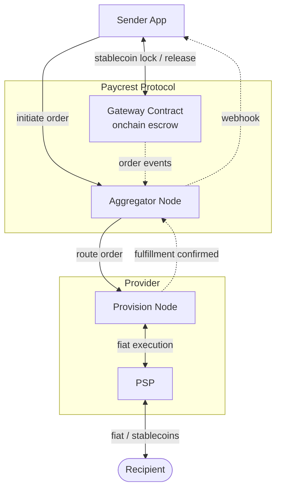

Paycrest is a payment routing protocol built on three cooperating layers: a Gateway smart contract for onchain escrow, an aggregator for order routing and coordination, and provision nodes for fiat execution. This page explains how those components interact.

## Core Components

### Gateway Contract

The **Gateway contract** is the onchain entry point for all payment orders. It holds stablecoins in escrow during the settlement process. Neither Paycrest nor any provider ever custodies the funds directly.

#### Key Functions

- **Order Creation**: Accepts payment orders from senders; locks stablecoins in escrow (off-ramp) or coordinates stablecoin release to recipients (on-ramp)
- **Event Emission**: Emits events that the aggregator monitors to begin routing
- **Escrow Settlement**: Releases escrowed funds to providers after fulfillment is verified, or returns them to senders if the order can't be completed

#### Payment Flow

<Steps>
  <Step title="Order Creation">
    Sender creates an order via the Sender API or direct contract interaction. For off-ramp, stablecoins are locked in escrow. For on-ramp, the contract coordinates stablecoin release once fiat receipt is confirmed.
  </Step>
  <Step title="Routing">
    Aggregator picks up the onchain event and routes the order to the most suitable liquidity provider based on rate, availability, and corridor.
  </Step>
  <Step title="Fulfillment">
    For off-ramp, the provider disburses fiat to the recipient via a local PSP. For on-ramp, the provider receives the user's fiat deposit and reports confirmation.
  </Step>
  <Step title="Completion">
    After fulfillment is verified, the contract settles atomically: escrowed stablecoins are released to the provider (off-ramp), or stablecoins are transferred to the recipient's wallet (on-ramp). If fulfillment fails, funds are automatically returned.
  </Step>
</Steps>

### Aggregator Node

The **aggregator node** is the coordination layer: it monitors onchain events, manages provider routing, and oversees the settlement pipeline.

#### Core Functions

- **Order Monitoring**: Watches the Gateway contract for new orders
- **Provider Matching**: Routes orders to the optimal provider based on rate and availability
- **Settlement Coordination**: Manages the fulfillment → validation → settlement flow
- **Webhook Delivery**: Notifies senders of order status changes

<Note>
  Paycrest operates the **Paycrest Aggregator** today. The protocol is designed to support multiple independent aggregators in the future. See the [Decentralization Path](/introduction#decentralization-path).
</Note>

#### API Layer

- REST API (v1 and v2 sender/provider endpoints)
- Webhook delivery to senders
- Rate limiting and authentication

### Provision Nodes

**Provision nodes** handle fiat execution: disbursing fiat to recipients for off-ramp orders, or receiving and confirming fiat deposits for on-ramp orders. They are run by independent liquidity providers who connect their own PSP integrations.

#### Components

- **PSP Integration**: Connects to local payment service providers (banks, mobile wallets)
- **Rate Management**: Sets and updates competitive rates per corridor
- **Order Processing**: Executes assigned payment orders
- **Settlement Reporting**: Reports fulfillment status back to the aggregator

#### Integration Types

<CardGroup cols={2}>
  <Card title="Bank APIs">
    - Direct bank integrations
    - Real-time payment rails
    - Batch processing
  </Card>
  <Card title="Mobile Money">
    - M-Pesa, Airtel Money, MTN Mobile Money
    - Other mobile wallets
  </Card>
</CardGroup>

#### Deployment Options

**Self-Hosted Deployment**
- Complete control over infrastructure and PSP connections
- Requires technical expertise for setup and maintenance
- Recommended for providers with existing PSP relationships

**Managed Deployment via Blockops**
- One-click deployment through [Blockops](https://blockops.network/)
- Automated scaling and monitoring
- Recommended for providers new to infrastructure management

### Sender API & Webhooks

The interface businesses and apps use to:

- **Create payment orders** in either direction, on-ramp or off-ramp
- **Configure** refund addresses, fee addresses and fee percentages
- **Manage API keys** and authentication
- **Receive webhooks** for every order status change

## Multi-Chain Support

The protocol is live on 6 EVM-compatible networks, where senders can use the Sender API or call the Gateway contract directly:

| Network | Chain ID | Primary Use |
|---------|----------|-------------|
| Ethereum | 1 | USDT, USDC, cNGN |
| Base | 8453 | USDT, USDC, cNGN |
| Arbitrum One | 42161 | USDT, USDC |
| Polygon | 137 | USDT, USDC, cNGN |
| BNB Smart Chain | 56 | USDT, USDC, cNGN |
| Celo | 42220 | USDT, USDC |

**Starknet** (`starknet`), **Tron** (`tron`) and **Solana** (`solana`) are supported through the Sender API only; Tron and Solana orders use the v2 API. See [Supported Stablecoins](/resources/supported-stablecoins) for tokens and address formats.

See [Gateway Contract Addresses](/resources/gateway-contract-addresses) for the EVM deployment table, and [Supported Stablecoins](/resources/supported-stablecoins) for per-network token details.

## Security Architecture

### Smart Contract Security

The Gateway contract implements multiple security measures:

- **Non-custodial escrow**: Funds are locked onchain, not held by Paycrest or providers
- **Automatic refunds**: Unfulfilled orders are refunded automatically
- **Access control**: Role-based permissions and multi-signature governance for protocol changes
- **Open-source contracts**: see the [contracts repository](https://github.com/paycrest/contracts)

### Data Protection

- **Encrypted recipient data**: Recipient bank details are encrypted in transit and at rest
- **API key authentication**: All API requests authenticated via API Key + API Secret
- **Webhook signature verification**: HMAC-SHA256 signatures on all webhook payloads

## Integration Paths

Senders have two integration options:

<CardGroup cols={2}>
  <Card title="Sender API" href="/implementation-guides/sender-api-integration" icon="code">
    REST API integration and the fastest way to go live. Paycrest handles the onchain interaction for you.
  </Card>
  <Card title="Smart Contract" href="/implementation-guides/smart-contract-interaction" icon="file-contract">
    Direct Gateway contract integration with full onchain composability. Automated flows like yield-to-fiat and liquidation-to-bank work natively.
  </Card>
</CardGroup>
